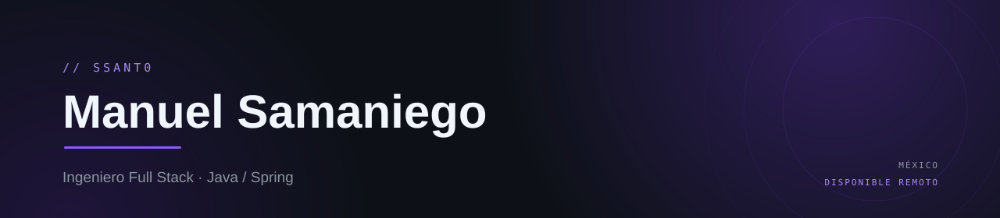
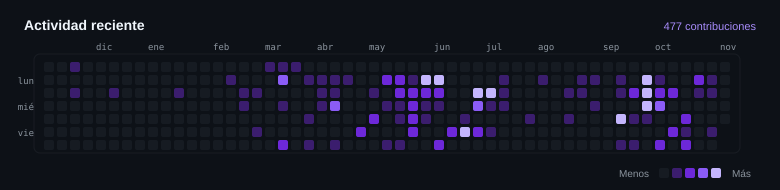

  

Ingeniero full stack con **4 años** construyendo APIs, SaaS y automatizaciones. 
Disponible para **freelance**, **colaboraciones** y **trabajo remoto**.

 

---

<h2 align="center">🧰 Stack</h2>

Java · Spring Boot · Angular · Astro · PostgreSQL · Docker <em>(aprendiendo)</em> · Go <em>(básico)</em>

---

<h2 align="center">📊 GitHub</h2>

  

  

  

Las métricas reflejan solo repositorios públicos.

---

🚴 Fuera del código: ciclismo.

# ssant0
